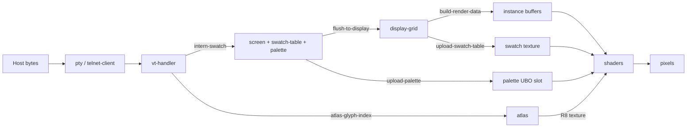

# Data Structures, First Edition: Specification

This document specifies the data structures that carry a character from a host
byte stream to a pixel in Lexter, and the invariants that bind them together.
It is a normative contract for anyone who adds a font loader, a pane class, a
protocol backend, or a renderer change, or who writes code that reads these
structures from outside their owning package. It describes the data model of
Lexter 0.1.0 at commit `2d4d743`. That model is due to be replaced; the
successor will be a second edition, which will supersede this one.

The key words MUST, MUST NOT, SHOULD, SHOULD NOT, and MAY in this document are
to be interpreted as described in RFC 2119.

The requirements state the *intended* contract, taken from the decision
records in the Logs and, where no record exists, from the development
transcripts cited in the front-matter. Where the code at `2d4d743` does not
meet a requirement, the requirement still stands, and the departure is listed
under [Known nonconformance](#known-nonconformance) in the Afterword. Each
requirement's grounds are given in a **Rationale:** line.

## Overview

Lexter is strictly bitmap and character-oriented. Every visible element,
including borders, scroll bars, and dialogs, is a glyph from a bitmap font
drawn into a cell (*Session transcript ses_2263-Lexter8*, line 3682). The data
model follows from that: a cell is a small record of integers, and everything
else is a table those integers index.

Three identifier spaces must not be confused:

Table: The three identifier spaces.

| Space | Meaning | Produced by | Held in |
|---|---|---|---|
| Codepoint | The key a font file declares for a glyph; Unicode in practice | the VT handler's decoder, or the TN3270 codec | the font's `encoding` table; the atlas's `codepoint-table`; `tn3270-screen` buffers |
| Font glyph index | An index into one font's `bitmaps` vector | a font loader | the font's `encoding` values and `wide-glyphs` keys |
| Atlas position | `row * cols + col` in the atlas grid, in single-width slots | `build-atlas` | every *glyph index* in the screen model, the display grid, and the GPU instance data |

In the rest of this document, **glyph index** means atlas position. It is
never a codepoint.

A cell's colour is reached through two indirections: the cell holds a
**swatch index**; the swatch holds four **palette indices**; the palette holds
an RGBA colour for each index. Changing a palette entry recolours every cell
that uses it without touching cell data, and changing a swatch recolours every
cell that uses that swatch (*Session transcript ses_2263-Lexter5*, lines
84-88).

Description: Host bytes arrive through a `pty` or a `telnet-client` and are
parsed by a `vt-handler`. The handler looks up each codepoint in the `atlas`
to get a glyph index, interns the current colours as a swatch, and writes both
into a `screen`, which also owns a swatch table and a palette. Each frame,
`flush-to-display` copies the screen's dirty rows and its swatch table into the
shared `display-grid`. The renderer packs the grid into GPU instance buffers,
uploads the grid's swatch table as a 1D texture, and uploads the screen's
palette directly into a slot of the palette uniform buffer, bypassing the grid.
The shaders combine instance data, the swatch texture, the palette, and the
atlas texture into pixels.

Ownership follows one rule: structs hold the per-cell, per-frame data where
speed matters, and CLOS classes hold the extension points (panes, workspaces).
Each structure has exactly one writer, named in its section.

## Required Font Representation

A font loader (`load-pcf`, `load-bdf`, `load-pbm-font`, `load-cp437-font`)
MUST return a `bitmap-font` (`src/pcf.lisp:bitmap-font@2d4d743`) that meets
these requirements.

Table: Requirements on `bitmap-font` slots.

| Slot | Type | Requirement |
|---|---|---|
| `cell-width` | `(unsigned-byte 16)` | MUST be the terminal's narrow ("half") cell width in pixels, and MUST be greater than 0 |
| `cell-height` | `(unsigned-byte 16)` | MUST be the cell height in pixels, and MUST be greater than 0 |
| `ascent` | `(unsigned-byte 16)` | the baseline's distance from the top of the cell; informative only, as no consumer reads it |
| `glyph-count` | fixnum | MUST equal the length of `bitmaps` |
| `bitmaps` | simple-vector | element *i* MUST be an `(unsigned-byte 8)` vector of `w × cell-height` bytes, where `w` is `2 × cell-width` if glyph *i* is wide and `cell-width` otherwise; row-major, top row first, row stride `w`; each byte MUST be 0 (background) or 255 (ink) |
| `encoding` | hash table, `eql` | MUST map each covered key (codepoint) to a font glyph index below `glyph-count` |
| `wide-glyphs` | hash table or NIL | MUST contain exactly the font glyph indices of double-wide glyphs, mapped to T; NIL when the font has none |

A loader MUST classify a glyph as wide if and only if its advance width
exceeds `cell-width`. It MUST extract a wide glyph's bitmap at `2 ×
cell-width`, not clip it to `cell-width`.

A loader MUST distinguish the **storage width**, the raster stride in the font
file, from the **cell width**. It MUST take the cell width from, in order: the
caller's `:cell-width` override; the advance of a representative narrow ASCII
glyph (`src/pcf.lisp:%detect-cell-width@2d4d743`); the storage width.
A PCF loader MUST take the cell height from the font's accelerator tables
(`fontAscent + fontDescent`) when they are present, and SHOULD fall back to
glyph 0's metrics only when they are absent.

**Rationale:** LEXTER-D34 separates storage width from
cell width, because Unifont stores every glyph in a 16-pixel raster but draws
ASCII in an 8-pixel cell (*Session transcript ses_1640-Lexter13*, lines
5109-5116 and 5186). LEXTER-D35 and -D3 put the
override first and auto-detection second. The accelerator rule fixes cells
measured from glyph 0's ink extents, which made haxor-narrow-16 come out 9×13
instead of 9×18 (*Session transcript ses_2263-Lexter8*, lines 1105-1131).

The `encoding` table is agnostic about its key space (*Session transcript
ses_2263-Lexter2*, line 2901). Fonts that share an atlas MUST share a key
space. A font whose native keys are not Unicode SHOULD be re-keyed to Unicode
at load time, as `load-cp437-font` does through `+cp437-to-unicode+`
(`src/pbm.lisp:load-cp437-font@2d4d743`).

**Rationale:** in a shared atlas, a CP437 byte value and the Unicode codepoint
with the same number name different characters (*Session transcript
ses_2263-Lexter2*, lines 2986-3015).

## Required Atlas Layout

`build-atlas` (`src/atlas.lisp:build-atlas@2d4d743`) is the sole writer of an
`atlas` (`src/atlas.lisp:atlas@2d4d743`). It packs an ordered list of fonts,
the **fallback chain**, into one texture.

Table: Requirements on the atlas.

| Item | Requirement |
|---|---|
| Fallback chain | every font in the chain MUST have the same `cell-width` and `cell-height` as the first; `build-atlas` MUST signal an error otherwise |
| Coverage | for each codepoint, the first font in the chain that covers it MUST supply the glyph |
| `codepoint-table` | MUST map each covered codepoint to its atlas position |
| Wide glyphs | a wide glyph at position *P* MUST occupy positions *P* and *P*+1; no other codepoint MAY be assigned *P*+1; `P mod cols` MUST be at most `cols − 2`, so a wide glyph never straddles an atlas row |
| `wide-set` | MUST contain exactly the positions of wide glyphs, mapped to T; NIL when there are none |
| `position-pixels` | MUST map every assigned position to the pixel vector blitted there, so the texture can be rebuilt |
| `cols` | MUST be at least 2, and MUST NOT change once any position has been handed out; `cols × cell-width` and `rows × cell-height` MUST NOT exceed `GL_MAX_TEXTURE_SIZE`, and `build-atlas` MUST signal an error rather than truncate |
| Texture | GL_R8, one byte per pixel, nearest filtering, clamp to edge, uploaded with unpack alignment 1; rows are uploaded top row first, and the shader UV formula relies on that |
| Position 0 | SHOULD hold a glyph that no screen needs to display, because glyph index 0 is reserved in the screen model (see [Required Screen Model](#required-screen-model)) |

Cursor glyphs (block, underline, bar) live at the Private Use Area codepoints
U+E000, U+E001, and U+E002. `add-cursor-glyphs`
(`src/atlas.lisp:add-cursor-glyphs@2d4d743`) appends them after the highest
position in use and rebuilds the texture. It MUST be called after
`build-atlas` and before a renderer is made from the atlas.

A lookup of an uncovered codepoint returns NIL. A writer MUST NOT store NIL as
a glyph index.

**Rationale:** one atlas means one texture binding and one cell size for the
whole window. The roughly square, size-bounded layout is
LEXTER-D38. `position-pixels` replaced a sequential
pixel vector when cursor glyphs needed the texture rebuilt after packing
(*Session transcript ses_2263-Lexter7*, lines 702-779).

## Required Colour Model

### Palette

A **palette** is a `(simple-array single-float (1024))`: entry *i* occupies
elements `4i` to `4i+3` as red, green, blue, and alpha, each in [0.0, 1.0].
`make-default-palette` (`src/model.lisp:make-default-palette@2d4d743`) is the
single canonical default: the 16 ANSI colours, the 6×6×6 cube at entries
16-231, and the grey ramp at 232-255. Every palette MUST be a copy of it until
something changes it.

Each `screen` owns its palette, with a `palette-generation` counter that starts
at 1. Every mutation of the palette (`set-palette-entry`,
`set-palette-entry-rgb8`, `reset-palette`) MUST increase the counter.

**Rationale:** LEXTER-D12 puts the palette on the
screen model because OSC colour sequences arrive through the handler that
already holds the screen, and so that each pane can have its own palette.
LEXTER-D13 chooses the generation counter.

### Swatches

A **swatch** is four palette indices, one per **slot**, each an
`(unsigned-byte 8)`.

Table: Swatch slot conventions.

| Slot | Role | Read by |
|---|---|---|
| 0 | background | the simple fragment shader where the glyph mask is 0; layer 0's `bg-slot` by default |
| 1 | foreground (ink) | the simple fragment shader where the mask is 1; layer 0's `ink-slot` by default |
| 2 | first overlay ink | layer 1, by convention |
| 3 | second overlay ink | layer 2, by convention |

Simple cells read only slots 0 and 1. A writer that has no use for slots 2 and
3 SHOULD fill slot 2 with the foreground and slot 3 with 0, as the VT path does.

**Rationale:** three layers fit four slots: layer 0 needs two colours and each
overlay needs one (*Session transcript ses_2263-Lexter7*, line 969).

A `swatch-table` (`src/model.lisp:swatch-table@2d4d743`) interns swatches.
`intern-swatch` (`src/model.lisp:intern-swatch@2d4d743`) MUST return the same
index for the same four slots within one table, and MUST increase the table's
`generation` exactly when it creates a new entry. Index 0 MUST be the default
swatch, slots (0 7 7 0). Swatch indices are stable for the life of a table but
depend on interning order, so they MUST NOT be stored or compared across
tables or sessions (*Session transcript ses_1640-Lexter14*, lines 1719-1736).

Every swatch index a writer places in a cell MUST be below 2048, the capacity
of the display grid's swatch data and of the GPU swatch texture
(`+swatch-table-size+`, `src/renderer.lisp:+swatch-table-size+@2d4d743`). The
GPU instance format would allow 15 bits (see
[Required GPU Instance Layout](#required-gpu-instance-layout)), so 2048 is the
binding limit.

### GPU colour stores

The **swatch texture** is a 1D GL_RGBA8 texture of 2048 texels with nearest
filtering. Texel *i* is swatch *i*, with channels r, g, b, and a holding slots
0 to 3. The shaders read it with `texelFetch` from a `sampler1D` and recover
each index as `uint(channel × 255.0 + 0.5)`.

**Rationale:** moving swatches to the GPU makes recolouring a swatch one small
texture upload rather than an instance rebuild (*Session transcript
ses_2263-Lexter4*, line 867). The normalised `sampler1D`, rather than an
integer `usampler1D`, works around a cl-opengl limitation (*Session transcript
ses_2263-Lexter5*, line 2576).

The **palette uniform buffer** is bound at binding point 0 to the block named
`Palette`, declared `layout(std140) uniform Palette { vec4 colors[1024]; }`.
It holds four **palette slots** (`+max-palette-slots+`) of 4096 bytes each
(`+palette-slot-size+`), 16384 bytes in all. Slot *s* begins at byte `s ×
4096`, and palette entry *i* of slot *s* is `colors[s × 256 + i]`. A palette
array uploads into a slot unchanged, because std140 gives a `vec4` array a
16-byte stride, the size of four single-floats. The uniform `u_palette_slot`
selects the slot used to draw.

**Rationale:** LEXTER-D16 chooses one larger buffer plus a
slot uniform over a palette texture or a texture array, and
LEXTER-D17 sizes it at four slots so it fits the 16384-byte
uniform block that every OpenGL 3.3 implementation guarantees. Panes MAY share
a slot; two panes that share a slot but need different palettes are a
configuration error (*Session transcript ses_2263-Lexter6*, lines 6869-6879).

## Required Screen Model

A `screen` (`src/model.lisp:screen@2d4d743`) is the logical state of one
terminal buffer, independent of rendering. Its writer is the backend that owns
it: the `vt-handler` for VT panes, or an application through the model API.

Cell (*col*, *row*) is at index `row × cols + col` in every per-cell array.

Table: Per-cell storage in `screen`.

| Slot | Element type | Length | Requirement |
|---|---|---|---|
| `glyphs` | `(unsigned-byte 32)` | `cols × rows` | atlas positions; 0 is reserved (below) |
| `swatch-indices` | `(unsigned-byte 16)` | `cols × rows` | indices into this screen's `swatches`, each below 2048 |
| `attrs` | `(unsigned-byte 32)` | `cols × rows` | attribute bits (below) |
| `wide-flags` | bit | `cols × rows` | 1 marks the left half of a double-wide character |
| `row-dirty` | bit | `rows` | 1 marks a row changed since the last flush |
| `layered-cells` | hash table, `equal` | sparse | key `(col . row)` to a `model-cell-layers` |

The glyph index is 32 bits wide because an atlas position counts slots, not
glyphs, and Unifont's atlas reaches about 107,000 slots
([LEXTER-0009](Log.EncodingRanges.md)).

**Glyph 0 and the blank glyph.** Glyph index 0 in `glyphs` is a sentinel
meaning "blank" and, to the right of a wide character, "continuation". A
consumer MUST render it as `screen-blank-glyph`. `blank-glyph` MUST be the
atlas position of U+0020 SPACE, set before the screen is written, and every
cell that holds no character MUST hold either `blank-glyph` or 0.

**Wide characters.** The screen has no continuation array; the right half is
implied (*Session transcript ses_2263-Lexter7*, line 1957). If
`wide-flags[i]` is 1, then cell *i* MUST NOT be in the last column, cell *i*+1
MUST hold glyph 0 with the same swatch, and `wide-flags[i+1]` MUST be 0. A
write that overwrites either half of a wide character MUST blank the other
half and clear the flag. Operations that move or clear cells (row copy, row
clear, insert and delete characters, resize) MUST carry or clear `wide-flags`
together with `glyphs`.

**Attributes.** Bits 0 to 4 are universal: bold (`#b1`), underline, blink,
reverse, and invisible (`+attr-bold+` to `+attr-invisible+`). Bits 5 to 7 are
reserved for further universal attributes. Bits 8 to 31 are mode-specific, and
their meaning depends on `mode` (`:unix`, `:3270`, or `:application`).

**Layered cells.** A cell is layered if and only if `layered-cells` has an
entry for it. The entry's `swatch-idx` replaces the simple swatch for drawing.
Its `layers` vector has `+max-layers+` (3) elements, each a `model-layer` or
NIL, and `topmost` MUST be the highest index whose layer is not NIL. Layer 0
MUST have `transparent-side :none`; layers 1 and 2 MUST have `:bg` or `:fg`.

Table: `model-layer` slots.

| Slot | Type | Meaning |
|---|---|---|
| `glyph-idx` | `(unsigned-byte 32)` | atlas position |
| `ink-slot` | `(unsigned-byte 2)` | swatch slot for ink; default 1 |
| `bg-slot` | `(unsigned-byte 2)` | swatch slot for background, read by layer 0 only; default 0 |
| `transparent-side` | keyword | `:none` opaque; `:bg` ink where the mask is 1, transparent elsewhere; `:fg` ink where the mask is 0, transparent elsewhere |

**Cursor and scrolling region.** `cursor-col` and `cursor-row` MUST satisfy
0 ≤ col < `cols` and 0 ≤ row < `rows`; `set-cursor-position` clamps.
`cursor-style` is one of `:block`, `:underline`, and `:bar`.
`scroll-top` and `scroll-bottom` are inclusive and MUST satisfy 0 ≤ top ≤
bottom ≤ `rows − 1`.

**Dirty rows.** Every mutation of a row's cells, and every cursor change that
affects a row, MUST set that row's `row-dirty` bit. `flush-to-display` clears
all bits. After anything replaces the content a grid is showing wholesale, such
as an alternate-screen swap, the writer MUST call `mark-screen-dirty`
(LEXTER-D33).

**Scrollback.** `scrollback-lines` is a ring of `scrollback-max` entries, and
`scrollback-count` is the total number of lines ever saved. Line *n*, counting
0 as the newest, is entry `(count − 1 − n) mod max`, and `scrollback-lines`
(the function) is `min(count, max)`. A line is saved only when a row scrolls
off the top of a scrolling region whose top is row 0, and only if
`scrollback-enabled`. Each saved line is a simple-vector, one element per
column, each element the list `(glyph swatch attrs)`. When scrollback is
enabled, `scrollback-max` MUST be greater than 0. `scrollback-viewport` is the
number of lines the view is scrolled back, 0 meaning the live screen.

**Modes.** `mode-flags` is reserved; `set-mode` and `get-mode` are stubs at
`2d4d743`, and DEC private modes are held by the `vt-handler` instead.

## Required Display Grid

A `display-grid` (`src/grid.lisp:display-grid@2d4d743`) is the GPU-facing copy
of the window's cells. There is one per window; every pane flushes into it.

Table: Per-cell and per-row storage in `display-grid`.

| Slot | Element type | Length | Meaning |
|---|---|---|---|
| `glyphs` | `(unsigned-byte 32)` | `cols × rows` | atlas positions, with no reserved values |
| `swatch-indices` | `(unsigned-byte 16)` | `cols × rows` | indices into `swatch-data` |
| `wide-flags` | bit | `cols × rows` | 1 on the left half of a wide character |
| `continuation-flags` | bit | `cols × rows` | 1 on the right half; such cells are not drawn |
| `layered-flags` | bit | `cols × rows` | 1 if the cell is layered |
| `layered-cells` | hash table, `equal` | sparse | key `(col . row)` to a `cell-location` |
| `row-dirty` | bit | `rows` | 1 marks a row written since the last build |
| `swatch-data` | `(unsigned-byte 8)` | `swatch-count × 4` | swatch *i*, slot *s* at `4i + s` |

The grid MUST maintain these invariants after every operation:

- `wide-flags[i]` is 1 if and only if cell *i* is not in the last column and
  `continuation-flags[i+1]` is 1.
- A continuation cell has glyph 0, the swatch of its left half, and is not
  layered.
- `layered-flags[i]` is 1 if and only if `layered-cells` has an entry for that
  cell.
- `swatch-count` is 2048, so that `swatch-data` matches the GPU swatch texture.

`set-simple-cell` (`src/grid.lisp:set-simple-cell@2d4d743`) writes a simple
cell. It MUST clear the cell's layered state, MUST clear the wide flag of a
wide character whose right half it overwrites, and MUST clear the continuation
of a wide character whose left half it overwrites. With `:wide`, it MUST also
write the continuation cell. A layered cell is created by `set-cell-swatch` or
`set-cell-layer`, which seed layer 0 from the cell's simple glyph and swatch;
`clear-cell-layers` returns a cell to simple mode.

Table: `cell-location` and `cell-layer`, the grid's layered records.

| Record | Slot | Type | Meaning |
|---|---|---|---|
| `cell-location` | `swatch-idx` | `(unsigned-byte 16)` | the swatch for every layer of the cell |
| `cell-location` | `layers` | simple-vector of 3 | `cell-layer` or NIL |
| `cell-layer` | `glyph-idx` | `(unsigned-byte 32)` | atlas position |
| `cell-layer` | `ink-idx` | `(unsigned-byte 2)` | swatch slot for ink |
| `cell-layer` | `bg-idx` | `(unsigned-byte 2)` | swatch slot for background, layer 0 only |
| `cell-layer` | `transparent-side` | keyword | as for `model-layer` |

The grid's `ink-idx` and `bg-idx` correspond to the model's `ink-slot` and
`bg-slot`; both are swatch slot numbers, not palette indices.

### From screen to grid

`flush-to-display` (`src/model.lisp:flush-to-display@2d4d743`) is the only
path from a `screen` to a grid. Given a column and row offset (for a pane, its
`pane-col` and `content-row`), it MUST:

1. copy the screen's swatch table into the grid's `swatch-data` whenever the
   grid's copy may differ from it (see [Required Synchronisation](#required-synchronisation));
2. for every dirty row, write each cell that falls inside the grid: a layered
   cell as its swatch and its non-NIL layers, and a simple cell through
   `set-simple-cell` with glyph 0 replaced by the blank glyph and with the
   model's wide flag;
3. draw the cursor, if visible, as reverse video, by interning a swatch with
   slots 0 and 1 exchanged into the screen's own swatch table and writing the
   cursor cell with it;
4. clear the screen's `row-dirty` bits.

The flush copies only cells; the palette does not pass through the grid
(LEXTER-D15). Because the cursor's swatch is interned
into the screen's table, drawing the cursor is a write to the model, and it
MAY increase the swatch table's generation.

## Required GPU Instance Layout

`build-render-data` (`src/grid.lisp:build-render-data@2d4d743`) packs the grid
into two byte buffers, and the vertex array objects made by the renderer read
them. All multi-byte fields are little-endian. `+simple-stride+` and
`+layered-stride+` (`src/grid.lisp:+simple-stride+@2d4d743`) are the single
source of the strides, and the renderer's attribute pointers MUST use them.

Table: Simple instance, 12 bytes.

| Bytes | Field | Type | Shader input |
|---|---|---|---|
| 0-1 | column | int16 | location 1, `ivec2 i_cell` |
| 2-3 | row | int16 | location 1 |
| 4-7 | glyph index | uint32 | location 2, `uint i_glyph` |
| 8-9 | swatch index; bit 15 set for a wide character | uint16 | location 3, `uint i_swatch` |
| 10-11 | padding | — | — |

Table: Layered instance, 16 bytes.

| Bytes | Field | Type | Shader input |
|---|---|---|---|
| 0-1 | column | int16 | location 1, `ivec2 i_cell` |
| 2-3 | row | int16 | location 1 |
| 4-7 | glyph index | uint32 | location 2, `uint i_glyph` |
| 8 | ink slot | uint8 | location 3, `uvec2 i_ink_bg` (x) |
| 9 | background slot | uint8 | location 3 (y) |
| 10 | transparent side: 0 `:bg`, 1 `:fg`, 2 `:none` | uint8 | location 4, `uint i_ts` |
| 11 | padding | — | — |
| 12-13 | swatch index; bit 15 set for a wide character | uint16 | location 5, `uint i_swatch` |
| 14-15 | padding | — | — |

Location 0 is the unit-quad corner, per vertex; locations 1 and up have divisor 1.

**Rationale:** the glyph index went from 16 to 32 bits with Unifont, and to 32
rather than 24 bits for clean attribute types; the padding keeps every
instance's 32-bit glyph 4-byte aligned (*Session transcript ses_1640-Lexter14*,
lines 11 and 1966). The wide flag rides in bit 15 of the swatch field so the
glyph field keeps its full range without a wider stride (*Session transcript
ses_2263-Lexter7*, lines 4122-4125). The shaders mask it off with `0x7FFF`.

The builder MUST emit one simple instance per simple cell that is not a
continuation cell, and one layered instance per non-NIL layer of each layered
cell that is not a continuation cell. Layered instances are grouped by depth:
all layer-0 instances, then all layer-1, then all layer-2, contiguous in one
buffer. A wide instance draws a quad two cells wide and samples two atlas
columns.

The renderer (`src/renderer.lisp:render-frame@2d4d743`) MUST draw the simple
instances with blending disabled, then each layer depth in order 0, 1, 2:
depth 0 with blending disabled, and depths 1 and 2 with `SRC_ALPHA,
ONE_MINUS_SRC_ALPHA`. It reaches each depth by moving the attribute pointers
to that depth's byte offset, because OpenGL 3.3 has no base-instance draw
(*Session transcript ses_2263-Lexter9*, lines 3754-3758).

In the vertex shader, the glyph's atlas column is `i_glyph mod cols` and its
row is `i_glyph div cols`, with `cols` and `rows` passed as `u_atlas_size`.

## Required Synchronisation

Copies of the same data live in the model, the grid, and the GPU. Generation
counters decide when a copy is refreshed.

Table: Generation counters.

| Counter | Starts at | Increased by | Compared against | On mismatch |
|---|---|---|---|---|
| `swatch-table-generation` (model) | 1 | `intern-swatch`, on a new entry | the grid's `swatch-generation` | `flush-to-display` copies the table into the grid |
| `display-grid-swatch-generation` | 0 | `set-swatch`; set to the model's value after a copy | `render-state-swatch-gen` | `upload-swatch-table` uploads `swatch-data` |
| `render-state-swatch-gen` | 0 | set to the grid's value on upload | — | — |
| `screen-palette-generation` | 1 | each palette mutation | `render-state-palette-gens[slot]` | `upload-palette` uploads the palette into the slot |
| `render-state-palette-gens[slot]` | 0 | set by `upload-palette` | — | — |

The counters MUST satisfy one invariant: **if a consumer's recorded
generation equals its producer's, the consumer's copy MUST equal the
producer's content.** Consequences:

- A counter MUST have one meaning. A store that more than one producer writes
  MUST NOT record a generation that can coincide with a state it does not hold.
- A consumer that is handed a different producer (another screen, a new grid,
  a reset terminal) MUST NOT trust a generation recorded from the previous
  producer, and MUST refresh unconditionally.
- Starting producers at 1 and consumers at 0 forces the first transfer.

`set-palette` uploads without recording a generation; only `upload-palette`
participates in this protocol.

## Required VT Handler State

A `vt-handler` (`src/vt-handler.lisp:vt-handler@2d4d743`) connects a cl-vt
parser to the screens it writes. It is the only writer of those screens.

**Buffers.** `screen` MUST always be the **active** buffer, and all writes go
to it. `primary-screen` is the normal buffer. `alt-screen` is the alternate
buffer: it is created on first use, persists for the handler's lifetime, has
the primary's columns, rows, mode, and blank glyph, and has scrollback
disabled. `in-alt-screen` is true exactly while `screen` is `alt-screen`, and
guards the swaps so that entering or leaving twice does nothing. The
`alt-saved-*` slots save the cursor and SGR state for modes 1048 and 1049, and
MUST stay separate from the DECSC slots (`saved-*`). `vt-handler-resize-all`
MUST resize both buffers. Any code that renders or reads a VT terminal MUST
find the screen through `vt-handler-screen`, or through
`vt-pane-active-screen`, at the time of use, and MUST NOT cache it.

**Rationale:** LEXTER-D28 (the handler owns the buffers and
the renderer follows it), -D2 (one persistent buffer, created lazily), -D3
(separate save slots), -D4 (resize both), -D5 (no scrollback on the alternate
buffer), and -D6 (pointer swap, not snapshot and restore).

**Palette across buffers.** OSC 4, 10, 11, and 104 MUST change the palette of
every buffer the handler owns, so a colour redefinition is shared by the normal
and alternate screens (`src/vt-handler.lisp:%handler-screens@2d4d743`).

Table: Other `vt-handler` state.

| Slot | Type | Requirement |
|---|---|---|
| `current-fg`, `current-bg` | `(unsigned-byte 8)` | palette indices 0-255; SGR truecolour MUST be mapped into this range (by `rgb-to-256`) |
| `current-attrs` | `(unsigned-byte 32)` | attribute bits for the next printed character |
| `tab-stops` | simple-bit-vector | length MUST equal the active screen's `cols` |
| `encoding` | `:utf8` or `:cp437` | in `:cp437`, each printable byte is translated through `cp437-table` (256 codepoints, or the default `+cp437-to-unicode+`) |
| `bold-as-bright` | boolean | when true, a bold foreground 0-7 is printed as 8-15; the promotion is baked into the interned swatch |
| `utf8-bytes-needed`, `utf8-codepoint` | `(integer 0 3)`, `(unsigned-byte 32)` | decoder state for printable bytes |
| `recording` | NIL or adjustable `(unsigned-byte 8)` vector | when non-NIL, `process-output` MUST append every byte before parsing it, and recording MUST NOT change parsing |
| `mouse-tracking` | NIL, `:normal`, `:button`, `:any` | modes 1000, 1002, 1003 |
| `mouse-encoding` | `:x10`, `:sgr` | mode 1006 selects `:sgr` |
| `callback` | function or NIL | called as `(funcall callback type data)` with a keyword type such as `:bell`, `:set-title`, `:report-cursor`, or `:unknown-osc` |

Mouse state belongs to the handler, not to a buffer, so it survives an
alternate-screen swap, and RIS MUST clear it so an application that dies
cannot leave the pointer grabbed ([LEXTER-DRAFT-mouse-reporting](Log.MouseReporting.md),
"Mouse state + encoding"). Tracking and encoding are independent settings
(LEXTER-DRAFT-mouse-reporting-D4).
Every printed character's swatch is interned as (`current-bg`, effective
foreground, effective foreground, 0).

## Required Pane Protocol

### Panes

`pane` (`src/panes/protocol.lisp:pane@2d4d743`) is the base class. `col` and
`row` are the pane's origin in the display grid, and `width` and `height` its
size, all in cells. `workspace` is a back-reference to the containing
workspace, set by the workspace's `initialize-instance :after` method; a pane
added to a workspace afterwards MUST have it set by the caller before its first
flush. A pane flushes only into its own rectangle.

**Rationale:** the back-reference was chosen over passing the workspace
through each flush call (*Session transcript ses_2263-Lexter6*, line 2589).

`input-redirect` is NIL or a function. While it is a function, the `:around`
methods on `pane-handle-key`, `pane-handle-char`, `pane-handle-mouse-button`,
`pane-handle-mouse-motion`, and `pane-handle-scroll` MUST divert the event to
it, called as `(funcall redirect pane kind &rest args)` with *kind* one of
`:key`, `:char`, `:mouse-button`, `:mouse-motion`, and `:scroll`. A redirect
passes an event on by calling a `pane-forward-*` function, which binds
`*redirect-suppressed*` to true so the event reaches the normal handler
without re-entering the redirect.

**Rationale:** LEXTER-D6 to -D4: modality is one slot of
pane state, interception lives in method combination rather than the router,
one function receives every kind of event, and passthrough uses a dynamic
binding. LEXTER-DRAFT-mouse-reporting-D7 extends the redirect to the pointer.

Mouse coordinates delivered to a pane MUST be cells relative to its content
area. While any button is held, every pointer event MUST go to the pane where
the press began. Motion is reported once per cell change
(LEXTER-DRAFT-mouse-reporting-D1 to -D3).

### Chrome

`chrome-pane` (`src/panes/chrome-mixin.lisp:chrome-pane@2d4d743`) is a mixin.
It does not inherit from `pane`, so a class MUST list it before a pane class
among its superclasses for its methods to take effect. It reserves the
rightmost column for a scroll bar when `scroll-bar-visible` is true, the top
`header-height` rows, and the bottom `footer-height` rows.

Table: Content geometry of a chrome pane.

| Function | Value |
|---|---|
| `content-width` | `width − 1` with a scroll bar, else `width` |
| `content-height` | `height − header-height − footer-height` |
| `content-row` | `row + header-height` |
| `scroll-bar-col` | `col + content-width` |

The chrome itself is drawn by the workspace's **decorator**, a function stored
on the workspace (*Session transcript ses_2263-Lexter6*, line 3043). It is
called as `(decorator workspace grid :borders)` for the workspace and as
`(decorator pane grid mode &key …)` for a pane, with *mode* one of `:header`,
`:footer`, and `:scroll-bar`. Chrome drawing happens after the pane's content
is flushed.

### VT panes

`vt-pane` (`src/panes/vt-pane.lisp:vt-pane@2d4d743`) holds a `screen`, a
`vt-handler`, and `palette-slot`, which is NIL (meaning slot 0) or 0 to 3. A
subclass supplies a backend by implementing six generic functions:
`vt-pane-write-bytes`, `vt-pane-read-bytes`, `vt-pane-backend-alive-p`,
`vt-pane-backend-destroy`, `vt-pane-backend-resize`, and
`vt-pane-write-string`. Its screen MUST be `content-width` × `content-height`,
and its backend MUST be told the same size.

`pane-palette` MUST return `(values palette generation slot)` for the active
screen, or NIL for a pane without a palette. `scroll-state` MUST return
`(values total-lines viewport-offset visible-rows)` or NIL, where
`viewport-offset` 0 means the live screen.

**Rationale:** LEXTER-D19 threads the slot through the
pane protocol.

### Workspaces and the compositor

A `workspace` (`src/panes/workspace.lisp:workspace@2d4d743`) holds a list of
panes and `focus-index`. Panes flush in list order, so a later pane overwrites
an earlier one where they overlap. Laying out the panes is the caller's
responsibility.

A `compositor` (`src/panes/compositor.lisp:compositor@2d4d743`) owns one
atlas, one display grid, and one renderer for all its workspaces. Every tick
it MUST process I/O for every pane of every workspace, and draw only the
active workspace. Switching workspace clears the grid. Before rendering, it
uploads the focused pane's palette into that pane's slot and makes that slot
the active one for the whole frame.

### Window lifecycle

A window-owning object (`unix-terminal`, `compositor`) implements
`gui-initialize`, `gui-tick`, `gui-destroy`, `gui-window`, and `gui-alive-p`
(`src/gui.lisp:gui-tick@2d4d743`). `gui-tick` MUST make its own GL context
current before drawing and returns NIL when the object is finished.
`gui-destroy` MUST be idempotent. `run-gui-loop` owns the event loop; the
caller initialises and terminates GLFW (LEXTER-D22, -D3,
-D6). The optional **stop flag** is a cons cell whose car is true while the
loop should run (LEXTER-D2, -D3).

## Required Backend State

### PTY

A `pty` (`src/pty.lisp:pty@2d4d743`) holds `master-fd`, `child-pid`, and
`alive-p`. `pty-read` MUST return the number of bytes read when data is
available, 0 when none is available, and −1 at end of file or on an error, and
MUST clear `alive-p` in the last case. The child's environment has
`TERM=xterm-256color`.

### Telnet

A `telnet-client` (`src/telnet/client.lisp:telnet-client@2d4d743`) has a
`mode` of `:telnet` or `:raw`. In `:telnet` mode, the receive path MUST remove
IAC command sequences and turn a doubled IAC (255 255) into one data byte 255,
and the send path MUST double every data byte 255. In `:raw` mode, bytes pass
unchanged in both directions. `cols` and `rows` are the size reported by NAWS.
The subnegotiation buffer `sb-buffer` holds 256 bytes.

### TN3270

A `tn3270-screen` (`src/tn3270/screen.lisp:tn3270-screen@2d4d743`) stores
**codepoints**, decoded from EBCDIC when the data stream is parsed, and the
pane looks them up in the atlas when it flushes. This is the opposite of the VT
`screen`, which stores atlas positions.

Table: Requirements on `tn3270-screen`.

| Slot | Requirement |
|---|---|
| `buffer`, `field-attrs`, `colors`, `highlights` | MUST each have length `cols × rows` |
| `field-attrs` | non-zero marks a cell holding a field attribute byte, which displays as blank; bit 5 is protected, bit 4 numeric, bit 0 the modified data tag |
| `cursor-address` | the operator's cursor; MUST be moved only by the IC order and by local keys |
| `buffer-address` | the host's paint pointer during a Write; reset to 0 at the start of each Write |
| `dirty` | one flag for the whole screen |

**Rationale:** when the paint pointer and the cursor were one field, IC could
not work, and "there is no correct one-line fix" (*Session transcript
ses_1640-Lexter11*, lines 1189-1200). A plain Write keeps the cursor where it
is, on purpose (line 1253).

A `tn3270-client` (`src/tn3270/client.lisp:tn3270-client@2d4d743`) frames
records at IAC EOR, removing doubled IACs from the record. Its receive buffer
holds 8192 bytes and its send buffer 4096. With TN3270E, each record begins
with a 5-byte header.

## Required PTYB Blob Format

A `.ptyb` blob holds the bytes a recording terminal received, for replay
(`src/test-rig.lisp:%frame-blob@2d4d743`).

Table: The `.ptyb` layout, version 1.

| Bytes | Content |
|---|---|
| 0-3 | magic, ASCII `PTYB` (`#x50 #x54 #x59 #x42`) |
| 4 | version, 1 |
| 5-8 | payload length *n*, unsigned 32-bit, big-endian |
| 9 to 8+*n* | payload: the bytes passed to `process-output`, in order |

A reader MUST reject a blob shorter than 9 bytes, with the wrong magic, with
another version, or whose length is not 9 + *n*. A payload MUST be replayable
on a terminal freshly reset with the same configuration (font, columns, rows,
pixel scale), which is set once for many blobs (*Session transcript
ses_1640-Lexter14*, line 1705).

The checksum of a replay is FNV-1a 64-bit over every byte of the `(H W 3)` RGB
capture, in row-major order (`src/test-rig.lisp:fnv1a-64@2d4d743`). Callbacks
that receive a capture are called with keyword arguments (`:width`,
`:height`, `:channels`, `:checksum`, `:name`, `:config`) and MUST accept
`&allow-other-keys`.

**Rationale:** LEXTER-D45 records raw input rather
than the cell matrix, which loses control state; -D3 compares exact pixels,
sound because the renderer is bitmap and nearest-neighbour; -D5 keeps blobs
apart from their expected checksums. The capture comes from the offscreen
framebuffer (LEXTER-D42).

## Conformance Walkthrough

### One narrow character

A shell in a `uterm-pane` at grid origin (*pc*, *pr*) prints red `A`: the
bytes `ESC [ 3 1 m A`. The cursor is at (*c*, *r*) of the pane's screen.

1. **Input.** The pane's `pane-process-output` reads the bytes through
   `vt-pane-read-bytes` and passes them to `process-output`. If recording, the
   handler appends all six bytes first ([Required PTYB Blob Format](#required-ptyb-blob-format)).
2. **SGR.** The parser dispatches `CSI 31 m`; `current-fg` becomes 1, a
   palette index ([Required VT Handler State](#required-vt-handler-state)).
3. **Glyph.** Byte `#x41` reaches `handle-print`, which decodes codepoint 65,
   and `%print-codepoint` (`src/vt-handler.lisp:%print-codepoint@2d4d743`)
   looks it up: `atlas-glyph-index` returns position *P*, not wide, and not 0
   ([Required Atlas Layout](#required-atlas-layout)).
4. **Swatch.** `intern-swatch` on the active screen's table with (0 1 1 0)
   returns index *k* below 2048, and increases the table's generation if the
   swatch is new ([Required Colour Model](#required-colour-model)).
5. **Model write.** `write-char-at` sets `glyphs[i] = P` and
   `swatch-indices[i] = k`, where *i* = *r* × `cols` + *c*, stores the
   attributes, clears `wide-flags[i]`, and marks row *r* dirty. The cursor
   advances to *c* + 1 ([Required Screen Model](#required-screen-model)).
6. **Flush.** On the next tick, the compositor flushes the active workspace.
   `pane-flush` finds the screen through `vt-pane-active-screen` and calls
   `flush-to-display` with offsets (*pc*, `content-row`). If the model's
   swatch generation differs from the grid's, the swatch table is copied, so
   `swatch-data[4k .. 4k+3]` = (0 1 1 0). Row *r* is dirty, so
   `set-simple-cell` writes cell (*pc*+*c*, *pr*+*r*) with glyph *P* and
   swatch *k* ([Required Display Grid](#required-display-grid)).
7. **Palette.** The pane is focused: `pane-palette` returns its screen's
   palette, generation, and slot *s*; `upload-palette` uploads it into slot
   *s* if the generation differs, and `set-active-palette-slot` selects *s*
   ([Required Synchronisation](#required-synchronisation)).
8. **Upload and pack.** `render-frame` uploads the swatch texture if the
   grid's generation differs from the renderer's, then `build-render-data`
   writes a 12-byte simple instance: column and row, *P* as four
   little-endian bytes, *k* with bit 15 clear, and two bytes of padding
   ([Required GPU Instance Layout](#required-gpu-instance-layout)).
9. **Vertex shader.** The instance becomes one cell-sized quad at the cell's
   pixel position, sampling atlas column `P mod cols` and row `P div cols`.
10. **Fragment shader.** Where the glyph mask is 1, the shader reads texel *k*,
    takes channel g (slot 1), recovers palette index 1, and outputs
    `colors[s × 256 + 1]`: in the default palette, red (170, 0, 0). Where the
    mask is 0, it takes channel r (slot 0), index 0, and outputs black.

Each step uses only the structures and requirements named in it; a component
that keeps those requirements can be replaced without the others noticing.

### A new VT backend

1. Define `(defclass my-pane (chrome-pane vt-pane) ...)`, or omit
   `chrome-pane` for a pane without chrome.
2. In `pane-initialize`, call `vt-pane-init-screen`, which sizes the screen
   from `content-width` and `content-height`, sets its blank glyph, and makes
   the handler; then open the backend at the same size.
3. Implement the six backend generic functions. `vt-pane-read-bytes` fills the
   pane's read buffer and returns a count; it MUST NOT block.
4. Read the screen through `vt-pane-active-screen` wherever it is needed.
5. Choose a `palette-slot` if the pane needs a palette different from other
   panes in slot 0.

## Afterword: Limits

### What this edition does not provide

Some limits are deliberate parts of this data model, and the second edition
may lift them:

- **One cell size.** An atlas has one cell size, and a compositor one atlas,
  so every pane in a window uses the same cell size. Fonts of different sizes
  cannot be mixed, and scaling them to match was rejected as contrary to the
  bitmap design.
- **One palette per frame.** The compositor activates the focused pane's slot
  for the whole frame, so every visible pane is drawn with that palette. Four
  slots exist; nothing allocates them.
- **Capacities.** 2048 swatches per window; 256 palette entries; 3 layers.
- **Truecolour is lossy.** SGR 24-bit colour is mapped to the nearest of 256
  palette entries.
- **PCF covers the Basic Multilingual Plane only**, because a PCF encoding is
  two bytes.
- **Stored but not drawn.** The attribute bits other than bold (through
  bold-as-bright), `cursor-style`, the cursor glyphs, and the scrollback
  viewport are recorded but do not change what is drawn. The cursor is always
  reverse video, and scrolled-back history is not displayed.
- **Full rebuild.** `build-render-data` rebuilds every instance every frame;
  the grid's `row-dirty` bits are written but not used to limit the work.
- **Missing glyphs are skipped.** A codepoint the atlas does not cover prints
  nothing; there is no replacement glyph.
- **Determinism is per machine.** Exact pixel checksums hold on one GPU and
  driver; across GPUs, rounding at quad edges is a risk, and software
  rendering is the fallback (*Session transcript ses_1640-Lexter14*, line
  2403).
- **Linux.** The PTY layer's ioctl and fcntl constants are Linux values.

### Known nonconformance

At commit `2d4d743` the code departs from this contract in the places below.
This list only locates them. Each is examined, with evidence and a severity,
in [LEXTER-DRAFT-data-structures-1e-critique](Eval.Critique.DataStructures1e.md),
which reproduces most of them and records further departures; the table after
the list gives the finding for each item.

1. **Wide characters lose their flag in the flush.** `flush-to-display` writes
   the right half of a wide character as an ordinary cell, and
   `set-simple-cell` then clears the left half's wide flag, so bit 15 never
   reaches the GPU through a screen
   (`src/model.lisp:flush-to-display@2d4d743`,
   `src/grid.lisp:set-simple-cell@2d4d743`). The VT path never writes wide
   characters at all (`src/vt-handler.lisp:%print-codepoint@2d4d743`).
2. **Wide flags are not maintained.** Row copy and clear, insert and delete
   characters leave `wide-flags` behind (`src/model.lisp:%copy-row@2d4d743`);
   `resize-grid` drops the grid's wide and continuation flags
   (`src/grid.lisp:resize-grid@2d4d743`); `put-char` places a wide character
   in the last column (`src/model.lisp:put-char@2d4d743`).
3. **Codepoint 32 used as a glyph index.** `make-screen` fills `glyphs` with 32
   (`src/model.lisp:make-screen@2d4d743`), as do `clear-grid` and the
   function-pane helpers (`src/panes/workspace.lisp:clear-grid@2d4d743`).
4. **Atlas position 0 is an ordinary glyph,** unreachable through a screen
   (`src/atlas.lisp:build-atlas@2d4d743`).
5. **Swatch indices can exceed 2048.** `intern-swatch` doubles the table when
   it fills, but the grid and texture stay at 2048
   (`src/model.lisp:intern-swatch@2d4d743`).
6. **The grid's swatch generation has two meanings.** `set-swatch` increases
   it, and `flush-to-display` overwrites it with the model's value, so equal
   numbers need not mean equal content (`src/grid.lisp:set-swatch@2d4d743`).
7. **Generations are compared across producers.** Palette generations from
   different screens share a slot's record, and `terminal-reset` gives a
   reused renderer a fresh grid and screen
   (`src/unix-term.lisp:terminal-reset@2d4d743`,
   `src/renderer.lisp:upload-palette@2d4d743`).
8. **One swatch store, many tables.** Every pane flushes its own screen's
   swatch table into the shared grid starting at index 0, and the TN3270 pane
   writes into it through a global cache
   (`src/tn3270-pane/tn3270-pane.lisp:*swatch-cache*@2d4d743`).
9. **Two default palettes.** The compositor's `make-xterm-palette` differs from
   `make-default-palette` at entry 7
   (`src/panes/compositor.lisp:make-xterm-palette@2d4d743`).
10. **Model layers cleared in the screen persist in the grid,** because the
    flush writes only non-NIL layers into an existing `cell-location`; and
    `write-char-at` ignores its swatch and attributes on a layered cell
    (`src/model.lisp:write-char-at@2d4d743`).
11. **VT handler ranges.** `rgb-to-256` can return 256
    (`src/vt-handler.lisp:rgb-to-256@2d4d743`), and `tab-stops` is not resized
    with the screen (`src/vt-handler.lisp:vt-handler-resize-all@2d4d743`).
12. **A cached screen.** `unix-terminal-screen` keeps the initial buffer after
    an alternate-screen swap, and the Origin integration reads it
    (`src/origin-impulse.lisp@2d4d743`).
13. **Backend size.** `uterm-pane` opens its PTY at the pane's size, not its
    content size (`src/panes/uterm-pane.lisp:pane-initialize@2d4d743`).
14. **Fixed TN3270 arrays.** The `tn3270-screen` arrays are always 1920
    elements, whatever `cols` and `rows` are
    (`src/tn3270/screen.lisp:tn3270-screen@2d4d743`).
15. **Telnet IAC doubling.** `telnet-write-string` masks each character to 7
    bits before testing it for 255
    (`src/telnet/client.lisp:telnet-write-string@2d4d743`).
16. **Drift in the descriptions.** README.md gives the strides as 8 and 12
    bytes and the glyph index as 16 bits; the cell comment in `model.lisp` and
    the shader comments also say 16 bits; `grid.lisp`'s header assigns slots
    2 and 3 to cursor and selection, which nothing does; and `+layered-stride+`
    is defined twice for one symbol (`src/renderer.lisp@2d4d743`).

Table: The critique finding that examines each item.

| Item | Finding |
|---|---|
| 1 | LEXTER-DRAFT-data-structures-1e-critique-O1 |
| 2 | LEXTER-DRAFT-data-structures-1e-critique-O8 |
| 3 | LEXTER-DRAFT-data-structures-1e-critique-O10 |
| 4 | LEXTER-DRAFT-data-structures-1e-critique-O10 |
| 5 | LEXTER-DRAFT-data-structures-1e-critique-O6 |
| 6 | LEXTER-DRAFT-data-structures-1e-critique-O2 |
| 7 | LEXTER-DRAFT-data-structures-1e-critique-O5 |
| 8 | LEXTER-DRAFT-data-structures-1e-critique-O4 |
| 9 | LEXTER-DRAFT-data-structures-1e-critique-O18 |
| 10 | LEXTER-DRAFT-data-structures-1e-critique-O9 |
| 11 | LEXTER-DRAFT-data-structures-1e-critique-O3 |
| 12 | LEXTER-DRAFT-data-structures-1e-critique-O11 |
| 13 | LEXTER-DRAFT-data-structures-1e-critique-O20 |
| 14 | LEXTER-DRAFT-data-structures-1e-critique-O13 |
| 15 | LEXTER-DRAFT-data-structures-1e-critique-O16 |
| 16 | LEXTER-DRAFT-data-structures-1e-critique-O21, -O18 |

The critique also records departures this list does not name:
LEXTER-DRAFT-data-structures-1e-critique-O7 (TN3270E negotiation), -O12 (the scrollback viewport and scroll bar),
-O14 (workspace switching), -O15 (autowrap and the scrolling region), -O17
(the headless and teardown paths), -O19 (package exports), and -O22 (the grid's
unused dirty bits).

### What would close the gap

The first edition's contract is met when each item above is fixed or the
requirement it breaks is deliberately changed. The second edition will
describe the new data model; when it is accepted it will carry `supersedes:`
naming this document, and this document will become `Superseded`.
